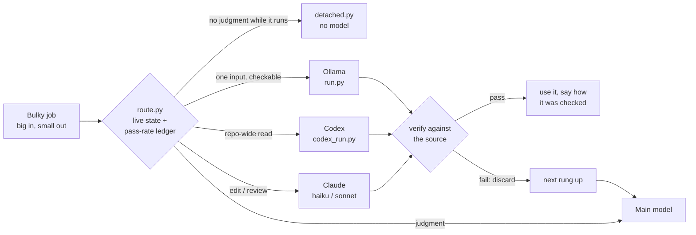

<div align="center">

# token-economy-delegation

### One router for local Ollama, Codex and Claude · a skill for Claude Code and OpenAI Codex

**Your best model shouldn't read 2,000 lines to return twelve.**<br/>
**Send every bulky job to the cheapest worker whose answer can be *checked* — and escalate the moment a check fails.**

**最貴的模型不該讀兩千行只為了回傳十二行。大量的機械工作交給「答案可以被驗證」的最便宜工人，驗證失敗就立刻往上交辦。**

[](LICENSE) [](#install) [](#install) [](#what-it-routes) [](#quality) [](#install) [](https://github.com/mixocreative/token-economy-delegation/stargazers)

[Quick start](#quick-start) · [How it works](#how-it-works) · [What it routes](#what-it-routes) · [What it caught](#what-it-caught) · [Quality](#quality) · [FAQ](#faq) · [Install](#install)

```bash
claude plugin marketplace add mixocreative/token-economy-delegation && claude plugin install token-economy-delegation@mixocreative-token-economy
```

</div>

---

Your agent reads a 2,000-line file to find twelve lines. It counts call sites by hand, summarises a log line by line, waits on a seven-hour test suite, then hits the usage limit and starts over. Most of that work needs no judgment at all, but it is all paid for at your most expensive model's price, out of your most limited resource: its context window.

Install this skill and your agent asks one question before each bulky step: ***could a grep have produced this answer?*** If yes, the job goes to the cheapest worker that can do it on **your** machine: a local Ollama model, Codex on its own quota, or a small Claude subagent. The answer is **checked against the source** before it is used, and if the check fails the job moves up a rung. Judgment, design and anything that ships stay with your main model.

> 你的 Agent 為了找十二行讀了兩千行、手動數呼叫點、逐行摘要 log、等七小時的測試，然後撞到用量上限重來。這些工作大多不需要判斷力，卻都用最貴的模型、最有限的 context 在付錢。裝上這個 Skill，Agent 每做一件大量工作前會先問：「這個答案 grep 做得出來嗎？」可以的話，就交給你機器上最便宜的工人（本機 Ollama、用自己額度的 Codex、或小型 Claude subagent），答案用原始資料驗證後才使用，驗證失敗就往上一階交辦。判斷、設計、要上線的東西，永遠留給主模型。

<a id="quick-start"></a>

## Quick start｜快速開始

### 1. Install｜安裝

```bash
claude plugin marketplace add mixocreative/token-economy-delegation && claude plugin install token-economy-delegation@mixocreative-token-economy
```

Codex, or a skills folder: see [Install](#install).

### 2. Ask your agent｜直接對 Agent 說

```text
Save tokens: list every conditional in OrderPage.php with a local model, and verify it.
```

```text
Use Codex to find every caller of reserve_stock() across the repo. Bring me only path:line.
```

```text
Get a second opinion on this branch from Codex before I merge.
```

```text
Run the full test suite detached so it survives if I hit the usage limit.
```

```text
幫我省 token：用本機模型把這份 log 的錯誤全部列出來，驗證過再給我。
```

### 3. Or ask the router yourself｜或自己問路由器

```bash
python route.py --status
#  Ollama : 3 usable (devstral-small-2:24b, gemma4:26b, qwen3.6:27b); desktop app 0.40.2 at [::1]:11434
#  Codex  : usable - ready
#  Claude : subagents always available (haiku: read+compress, sonnet: bounded edit/review)

python route.py --job list --files src/OrderPage.php
#  USE Ollama qwen3.6:27b [score 2.4 (fit2 q0.50 loaded)]: python run.py --task list --number-lines --prompt "..." < input
#    skip Codex: ~3,409 tokens of input is below its per-call overhead - a subagent is cheaper overall
#    then: Claude haiku subagent  ->  main model, inline
```

The router costs no model tokens and never runs the job. It reads live state: which Ollama models are installed and healthy, whether the input fits them and the free VRAM, whether Codex is cooling down after a usage limit, and how often each worker has **actually passed verification on this job type on your machine**.

<a id="how-it-works"></a>

## How it works｜運作方式



Every attempt is written to a local ledger (`~/.token-economy/ledger.jsonl`). A worker that keeps failing a job type on your machine stops being chosen for it.

<a id="what-it-routes"></a>

## What it routes｜交辦給誰

| Job | First choice | What it needs | Fallback chain |
|---|---|---|---|
| Long non-AI step: test suite, build, GPU or installer run | **No model** (`detached.py`) | Python | — |
| Mechanical work on one input: list, extract, count, classify, reformat | **Local Ollama** (`run.py`) | Ollama, any models: discovered live, started if it isn't running | Codex → Claude haiku → main |
| Repo-wide read with a short answer ("every caller of X") | **Codex** (`codex_run.py task`, cheap tier) | Codex CLI | Claude Explore/haiku → main |
| Bounded edit of 1–2 files | **Claude sonnet** subagent | Claude Code | main |
| Second opinion on finished work | **Codex** (`codex_run.py audit`, mid tier) | Codex CLI | Claude sonnet reviewer → main |
| Judgment, design, security, grading, anything that ships | **Main model**, never delegated | — | — |

No Ollama? No Codex? It skips them and still saves tokens with Claude subagents and detached runs.

<a id="what-it-caught"></a>

## What it caught on day one｜第一天就抓到的問題

Built and tested on a real workstation (RTX 3090, Windows, Ollama desktop app, Codex CLI). The old hard-coded version had missed every one of these:

| Found | What was true |
|---|---|
| **Every default local call failed** | The skill named models that weren't installed. Discovery now reads what is actually there. |
| **The wrong Ollama answered** | Another listener owned `127.0.0.1:11434` and answered with a different model set, so requests landed on either server at random. The skill now talks only to the native install, and starts the desktop app if it isn't running. |
| **Every Codex audit had been failing** | The configured Codex model was rejected by the account. The router now picks from Codex's own model list and remembers rejected models. |
| **Right names, wrong lines** | Codex's cheapest tier named every subcommand correctly and got every line number wrong, three runs in a row; one cited a line past the end of the file. `refs.py` caught it each time, and the automatic retry one tier up came back **6/6 grounded**. The main model never read the file. |
| **A 48-token question cost 42k Codex tokens** | Codex loaded its skills on every call. A short "delegated sub-task" preamble fixes that, and the router keeps Codex for reads big enough to be worth its overhead. |

And the cascade working as designed: `qwen3.6:27b` listed all 10 function definitions in a 253-line file. All 10 were grounded and matched `grep`, at 90 tok/s, and about 4,400 tokens never entered the main context.

Tried it on your setup? [Open an issue](https://github.com/mixocreative/token-economy-delegation/issues) with your models, the job and what `run.py --stats` says. Real hardware numbers make the routing better for everyone.

<a id="quality"></a>

## Why it doesn't cost quality｜為什麼不犧牲品質

Cheap-and-unverifiable is not cheap. It is a defect your main model pays for later. So every rung below the main model is **checked mechanically against the source**, and the failed answer is thrown away, never patched.

| Check | What must hold | Applies to |
|---|---|---|
| `quotes` | every cited line exists verbatim, at the line number given | Ollama lists, extracts, reviews, summaries |
| `count` | the number equals a regex count of the input | Ollama counts |
| `json` | parses, with the schema's required keys (structured output enforced) | Ollama classification |
| `refs` | every `path:line` holds the text it claims | Codex and subagent replies |
| `TRUNCATED` | an answer cut at the token limit is rejected, never used | all |
| `--agree` | two different local models must agree; the output is their intersection | optional, Ollama |

Runs are deterministic: temperature 0, thinking off for mechanical work, think-blocks stripped, and context sized from the input.

> 便宜但無法驗證，其實不便宜，那是主模型之後要付的代價。所以主模型以下的每一階都用原始資料做機械式驗證，失敗的答案直接丟掉、不修補。

<a id="detached-runs"></a>

## Detached runs｜脫離 Session 的長任務

Background commands in Claude Code and Codex die with the session. A usage limit halfway through a seven-hour suite means running it all again. `detached.py` starts long work as its own process, so the next session reads the result instead of re-running it:

```bash
python detached.py start suite -- python -m pytest -q   # from the project root
python detached.py status                             # running / stalled / done (exit code) / died
python detached.py watch                              # wakes only when a run ends, dies or stalls
python detached.py tail suite 40
```

Nothing lingers. Every run has a hard time limit (`--max-hours`, default 6) that kills its whole process tree, `stop NAME` ends it at once, and nothing registers to start with the OS.

<a id="faq"></a>

## FAQ｜常見問題

<details>
<summary><strong>Won't a cheaper model make the result worse?｜便宜模型不會讓品質變差嗎？</strong></summary>

Only judgment-free work is delegated. Every result is verified mechanically before use, and a failed check escalates to a stronger worker. If a grep could have produced it, a local model may. If it needs the codebase's meaning, a grade or a decision, it stays with the main model.
</details>

<details>
<summary><strong>Do I need Ollama, Codex, or a GPU?｜一定要有 Ollama、Codex 或顯示卡嗎？</strong></summary>

None of them. Without Ollama the router skips local models. Without Codex, or while it's out of credit (the cool-down is read from Codex's own "try again in …"), it goes straight to Claude subagents. Detached runs need only Python. More workers means more savings.
</details>

<details>
<summary><strong>Does my code leave my machine?｜程式碼會離開我的電腦嗎？</strong></summary>

Ollama jobs run entirely on your machine. Codex and Claude subagent jobs go to those providers under their own policies, as your agent already does. The skill adds no service of its own and sends nothing anywhere else.
</details>

<details>
<summary><strong>Which Ollama does it use?｜用哪一個 Ollama？</strong></summary>

The native install. On Windows that's the desktop app's server, reached on `[::1]:11434`. If it isn't running, the skill starts the desktop app (or `ollama serve` when only the CLI is installed). It never stops or restarts a running server. Set `OLLAMA_HOSTS` to point it elsewhere.
</details>

<details>
<summary><strong>When is delegating a waste?｜什麼時候不該委派？</strong></summary>

Small in, small out. A handoff costs a prompt, a reply and a check, so a five-line lookup is cheaper done inline. The router says so when the input is small.
</details>

<a id="install"></a>

## Install｜安裝

**Claude Code plugin (recommended)｜Claude Code 外掛（推薦）**

```bash
claude plugin marketplace add mixocreative/token-economy-delegation
claude plugin install token-economy-delegation@mixocreative-token-economy
```

**Skills folder, shared by Claude Code and Codex｜手動放置，Claude Code 與 Codex 共用一份**

```bash
git clone https://github.com/mixocreative/token-economy-delegation ~/skills/token-economy-delegation
ln -s ~/skills/token-economy-delegation ~/.claude/skills/token-economy-delegation   # Claude Code
ln -s ~/skills/token-economy-delegation ~/.codex/skills/token-economy-delegation    # Codex
```

On Windows use `mklink /J <link> <target>` in place of `ln -s`. Requirements: Python 3.10+ (standard library only). Optional: [Ollama](https://ollama.com) and the [Codex CLI](https://github.com/openai/codex).

## Files｜檔案

| File | Purpose |
|---|---|
| `SKILL.md` | the ladder, the verification rules, common mistakes: what your agent reads |
| `route.py` | who should do this job, with the exact command and the fallback chain |
| `run.py` | local Ollama: start, discover, route, run, verify, escalate, ledger, bench, stats |
| `codex_run.py` | read-only Codex task / audit: model tier from Codex's own list, usage-limit cool-down, reference check |
| `refs.py` | checks every `path:line` a delegated reply cites against the files |
| `detached.py` | long runs outside the session: start / status / watch / stop / tail |
| `ollama_review.py` | emergency first-pass review per changed file (never a verdict) |
| `codex_audit.py` | kept for old prompts: same as `codex_run.py audit` |
| `routing.json` | optional: override which model families suit code / prose / Chinese |

## More skills by MixoCreative｜更多 MixoCreative 的 Skill

- **[cia](https://github.com/mixocreative/cia)**: Code Integrity Auditor. Finds the bugs that live *between* two correct functions, and proves what it checked.
- **[ecommerce-cia](https://github.com/mixocreative/ecommerce-cia)**: Commerce Integrity Auditor. Payments, stock, refunds and invoices, with live-verified Taiwan gateways (藍新、綠界、LINE Pay).

## Star history｜Star 趨勢

<a href="https://www.star-history.com/#mixocreative/token-economy-delegation&Date">
  <picture>
    <source media="(prefers-color-scheme: dark)" srcset="https://api.star-history.com/svg?repos=mixocreative/token-economy-delegation&type=Date&theme=dark" />
    
  </picture>
</a>

If it saved you a usage limit, a ⭐ helps the next person find it.｜如果它幫你省下了用量，給個 ⭐ 讓更多人找到它。

## Inspired by｜參考

- [Houtini LM](https://mcpservers.org/servers/houtini-ai/lm): model discovery, performance memory per machine, truncation flags, and "Claude is the architect, the other model drafts, Claude checks".
- [claude-ollama-agents](https://github.com/PratikHotchandani22/claude-ollama-agents): role-specific local agents and token stats.
- [SerpentStack model-routing](https://openskillindex.com/skills/benja-pauls-serpentstack-model-routing): keeps planning and review on the cloud model, and verifies with the project's own checks.
- [RouteLLM](https://github.com/lm-sys/RouteLLM): routes between a cheap and a strong model by predicted quality. This skill uses a cascade instead: try cheap, verify, escalate.
- [REA](https://github.com/morluto/rea): "every conclusion distinguishes observations, inferences and unknowns".

## Contributing｜貢獻

Bug, new worker or better verifier? [Open an issue](https://github.com/mixocreative/token-economy-delegation/issues) or a pull request. Measured results on your hardware are the most useful contribution.

## License｜授權

[MIT](LICENSE)
